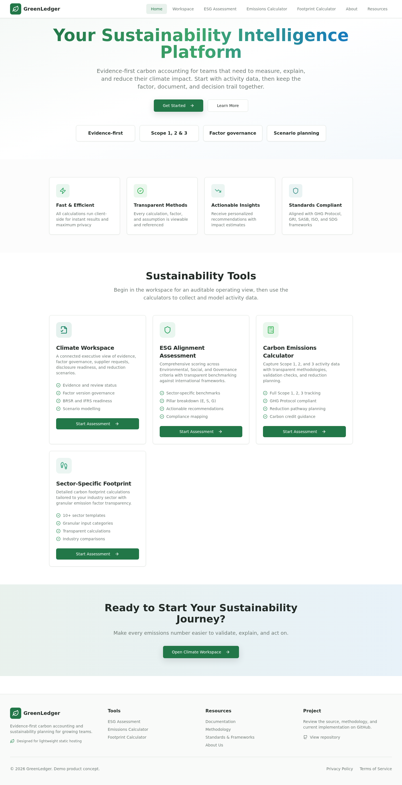
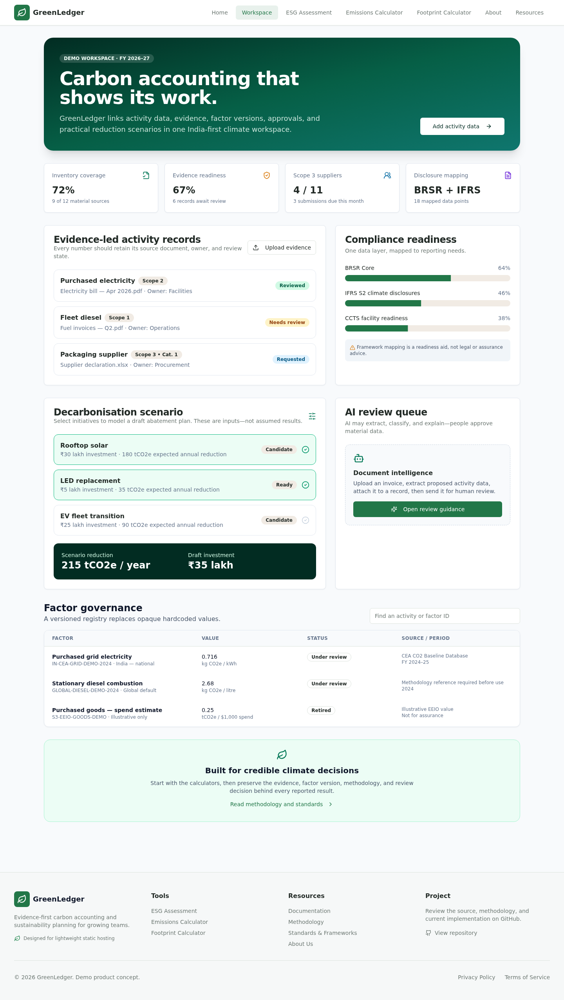
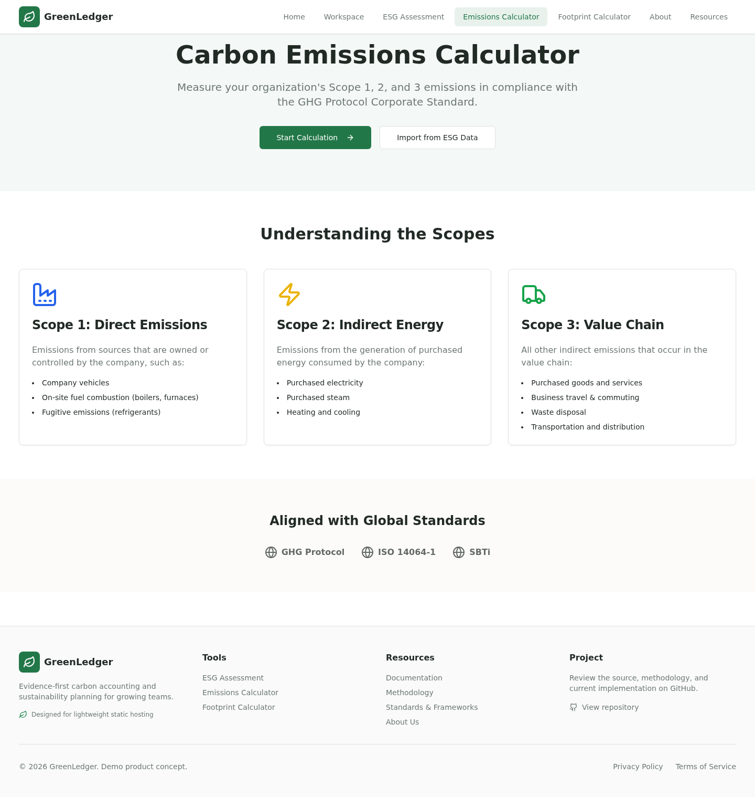
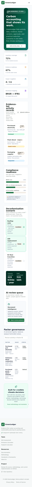

# GreenLedger: Carbon Insight Hub

An evidence-first climate accounting and ESG workspace for teams that need to measure, explain, and reduce emissions without hiding the source, factor version, review state, or assumptions behind a number.

**Live demo:** https://carbon-insight-hub.surge.sh  
**Repository:** https://github.com/Pranay1301/carbon-insight-hub

## Demo

[Watch the 8-second interactive walkthrough](./docs/demo/carbon-insight-hub-demo.mp4)

The recording exercises real navigation and form entry with fixture/demo data only; it does not use live customer data.









## What this upgrade adds

- A polished landing page and India-first Climate Workspace for inventory coverage, evidence readiness, supplier collection, BRSR and IFRS readiness, factor governance, and decarbonisation scenarios.
- Responsive desktop and mobile layouts, including fixed mobile navigation, wrapped controls, readable cards, and no horizontal overflow on the tested routes.
- Cleaner shell and navigation, with real project links instead of placeholder social or contact links.
- Scope 1, 2, and 3 emissions workflows, sector footprint calculators, ESG assessment forms, and ESG due-diligence modules.
- Stronger TypeScript coverage across calculators, ESG forms, storage, generated Supabase types, error handling, and form save flows.
- Optional Supabase persistence with a standalone browser demo fallback when environment variables are not configured.
- A rewritten README with current screenshots, a demo video, local setup, deployment notes, and explicit limitations.

## Core workflows

### Climate Workspace

The workspace combines activity records, review status, factor governance, framework readiness, and scenario planning. Scenario totals are draft calculations from user-selected inputs; they are not presented as assured reduction results.

### Carbon Emissions Calculator

Covers organizational Scope 1, Scope 2, and Scope 3 data capture, dashboards, reduction planning, and report generation.

### Sector Footprint Calculators

Includes sector-specific entry points, energy and transport calculators, methodology information, and a dashboard for footprint results.

### ESG Assessment and Due Diligence

Includes profile, environmental, social, and governance forms, results and report pages, materiality, risk, data-process, stakeholder, gap-analysis, scoring, and final-report flows.

## Tech stack

- React 18 and TypeScript
- Vite
- Tailwind CSS and shadcn/ui
- React Router
- React Hook Form and Zod
- Recharts
- Optional Supabase browser client

## Run locally

```bash
npm install
npm run dev
```

Open the local URL printed by Vite, usually `http://localhost:5173`.

The app runs in standalone demo mode without environment variables. Browser draft data stays local in that mode.

## Optional Supabase setup

Copy `.env.example` to `.env` and provide only browser-safe public configuration:

```env
VITE_SUPABASE_URL=https://your-project.supabase.co
VITE_SUPABASE_PUBLISHABLE_KEY=your-publishable-key
```

Do not put a Supabase service-role key in a `VITE_` variable. Do not commit a local `.env` file.

## Build and checks

```bash
npm run lint
npm run build
npx tsc -p tsconfig.app.json --noEmit
```

Current local verification for this upgrade:

- Production build passes with Vite.
- ESLint passes with 0 errors and 9 warnings.
- Strict application TypeScript check passes.
- Desktop and mobile visual QA passed on `/`, `/workspace`, `/carbon-emissions`, `/carbon-footprint`, `/carbon-footprint/dashboard`, `/esg-due-diligence`, and `/about` with no console errors or horizontal overflow in the final checks.
- Compatible dependency fixes were applied for the direct runtime high-severity audit findings in `react-router-dom` and `zod`. The remaining high-severity finding is the Vite development server chain and requires a breaking Vite major upgrade; the deployed static site does not run that server. Remaining moderate findings are documented by `npm audit` and include a React Router advisory that requires a separate v7 migration review.

The production bundle currently emits Vite's standard warning that the main JavaScript chunk is larger than 500 kB. Future optimization should split calculator and ESG routes with dynamic imports.

## Deployment

The app is a static Vite build and can be deployed free on Vercel, Netlify, Cloudflare Pages, or GitHub Pages with SPA rewrites.

```bash
npm run build
```

Publish the `dist/` directory. For Vercel, the included `vercel.json` rewrites client-side routes to `index.html`.

## Architecture notes

- `src/pages/ClimateWorkspace.tsx` contains the evidence-first workspace.
- `src/lib/carbon/` contains factor registry, calculation, and validation support.
- `src/pages/carbon/` contains organizational Scope 1, 2, and 3 workflows.
- `src/pages/carbon-footprint/` contains sector footprint calculators and dashboards.
- `src/pages/esg/` contains ESG assessment forms and reports.
- `src/pages/esg-due-diligence/` contains due-diligence setup, assessment, scoring, and report flows.
- `src/integrations/supabase/` contains optional Supabase client and generated types.

## Truthful limits

This is a product-quality demo and portfolio build, not a verified reporting or assurance system. Sample factors, readiness percentages, and scenario outputs are illustrative unless connected to reviewed source datasets and organization-specific evidence.

Before external reporting or production use:

- Replace illustrative factors with reviewed, versioned source data.
- Configure organization-scoped Supabase tables, row-level security, roles, and evidence storage.
- Retain factor ID, methodology version, source document, reviewer decision, and calculation run with every reported result.
- Have qualified reviewers validate material disclosures and regulatory outputs.
